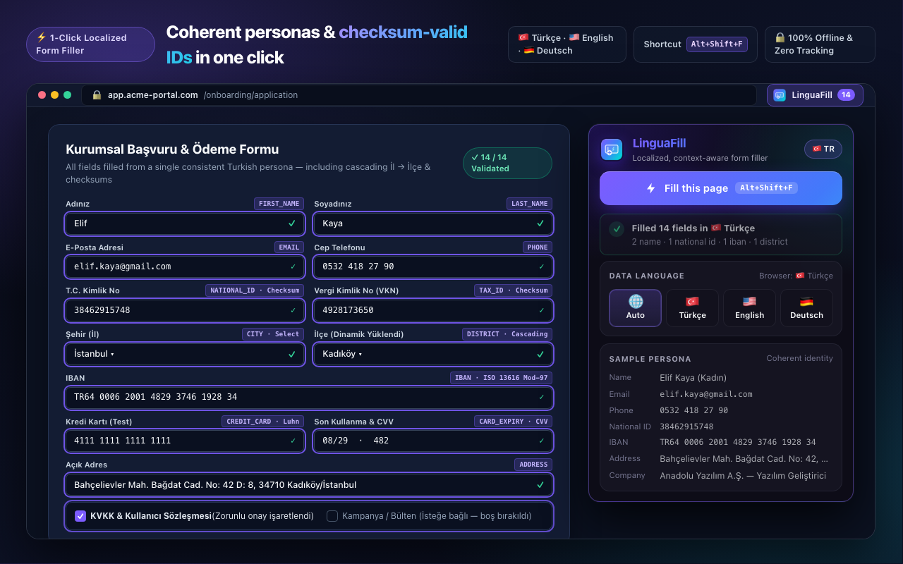

# LinguaFill — Localized Form Filler

<p align="center">
  
</p>

<p align="center">
  <strong>Context-aware, localized mock data form filler for Google Chrome (Manifest V3).</strong><br>
  Generates coherent personas in 🇹🇷 Turkish, 🇺🇸 English, and 🇩🇪 German — complete with checksum-valid National IDs, Tax IDs, IBANs, Luhn test cards, and cascading dropdown support.
</p>

<p align="center">
  
</p>

---

## ✨ Features

- **Coherent Single-Persona Runs:** Instead of filling each input independently, LinguaFill builds one consistent persona per fill. First name, last name, username, email, gender, birth date, age, city, district, postal code, and phone area code all match each other. Password and confirm-password fields always receive the same value.
- **Checksum-Valid Identifiers:**
  - **T.C. Kimlik No (`NATIONAL_ID`):** 11-digit Turkish National ID passing the official 10th & 11th digit checksum algorithm (plus US SSN and German Personalausweis formats).
  - **Vergi Kimlik No (`TAX_ID`):** 10-digit Turkish VKN with valid check digit (plus US EIN & German Steuer-ID).
  - **IBAN (`IBAN`):** ISO 13616 `mod-97` verified IBANs for `TR`, `GB`, and `DE`.
  - **Payment Cards (`CREDIT_CARD`, `CARD_EXPIRY`, `CVV`):** Well-known Luhn-valid sandbox test card numbers, future expiry dates, and CVV codes.
- **Cascading & Dynamic Forms:** Fills `<select>` and radio controls first, observes DOM mutations via `MutationObserver`, and automatically runs follow-up passes to populate dependent fields (such as **City → District / İl → İlçe** dropdowns).
- **SPA & Modern Widget Support:**
  - Uses native HTML prototype value setters and dispatches `FocusEvent`, `InputEvent`, `KeyboardEvent`, and `PointerEvent` sequences so **React, Vue, and Angular** update their internal state.
  - Simulates character-by-character typing for **input masks** (`(___) ___ __ __`, IMask, Inputmask) and validates via `el.validity.valid`, falling back to alternative formats or synthesizing values directly from HTML `pattern` regexes.
  - Supports `[contenteditable]` rich-text editors and ARIA `role="combobox"` / `aria-haspopup="listbox"` custom dropdowns (React-Select, MUI, Ant Design, etc.).
- **Smart Checkbox & Radio Handling:** Ticks required agreement/KVKK/GDPR consent checkboxes while leaving optional marketing/newsletter opt-ins unticked by default. Skips honeypots, search boxes, and OTP fields.
- **100% Offline & Private:** Zero network requests, zero telemetry, and no broad host permissions (`activeTab` + `scripting` only).

---

## ⌨️ Keyboard Shortcuts

| Action | Default Shortcut |
| :--- | :--- |
| Fill all forms on the active tab | `Alt+Shift+F` |
| Open the LinguaFill popup | `Alt+Shift+L` |

Shortcuts can be customized anytime at `chrome://extensions/shortcuts`.

---

## 🚀 Installation (Developer Mode)

1. Clone this repository:
   ```bash
   git clone https://github.com/elmastahsin/fake-filler-extension.git
   cd fake-filler-extension
   ```
2. Open `chrome://extensions` in Google Chrome and enable **Developer mode** (top-right toggle).
3. Click **Load unpacked** and select the project root directory.
4. Open [`demo.html`](demo.html) in Chrome and press `Alt+Shift+F` (or click the LinguaFill toolbar icon → **Fill this page**).

---

## 📦 Testing & Packaging

Run the unit test suite (classifier heuristics, TCKN/VKN/IBAN/Luhn checksums, pattern generator, and locale generators):

```bash
npm test
```

Build a clean Chrome Web Store release archive in `dist/linguafill-<version>.zip`:

```bash
npm run pack
```

Regenerate the extension icons (`16`, `32`, `48`, and `128` px RGBA with a 16 px transparent margin):

```bash
python3 scripts/make_icons.py
```

---

## 🔒 Privacy Policy

LinguaFill operates strictly offline inside your browser and never collects, reads, or transmits any personal or form data. Read the full [Privacy Policy](store/privacy-policy.md).
